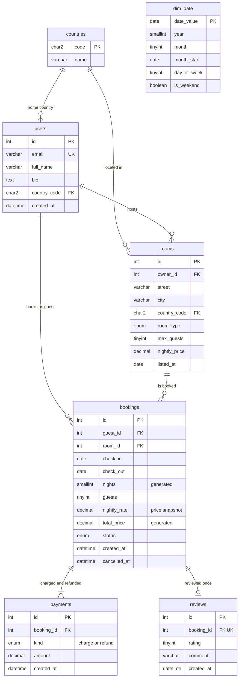

# Fireship-Exercise

SQL analytics on a vacation-rental marketplace, built in MySQL 8. A schema with real
constraints, a booking engine that cannot double-book, twelve business questions
answered with window functions, CTEs and cohort analysis, and a data-quality suite
that checks the data every time.

It started as an exercise following Fireship's MySQL tutorial (users, rooms and
bookings). The tutorial gives the idea and the first tables; everything else here was
added on top: the data, the rules, the analysis, the tests and the performance work.

> **The data is synthetic.** It is generated by `scripts/generate_seed.py`, and two
> patterns are planted on purpose so the queries have something to find. See
> [Limitations](#limitations).

## Quickstart

You need MySQL 8.0.16 or newer (CHECK constraints are enforced from that version) and
Python 3. The generator uses only the standard library. Run the commands from the
repository root (on Windows use `py` if `python` is not found).

```bash
# 1. generate the data (writes sql/02_seed.sql, about 1.4 MB)
python scripts/generate_seed.py

# 2. build the database
mysql -u root -p
mysql> source run_all.sql
```

`run_all.sql` drops and recreates a database called `rental_analytics`, loads the data,
creates the views and booking rules, and runs the data-quality checks. It takes about a
second. It uses `source` instead of `<` redirection so it also works in Windows
PowerShell.

Then, from the same `mysql>` prompt:

```sql
source sql/04_analysis.sql        -- the twelve questions
source sql/05_performance.sql     -- the indexing lab (rebuild first to run it again)
source sql/07_booking_demo.sql    -- try the booking rules (changes data; rebuild to reset)
```

Tests (Python 3 and the `mysql` client on the PATH; set `MYSQL_USER`, `MYSQL_PWD` or
`MYSQL_HOST` if the defaults do not fit):

```bash
python tests/test_booking_rules.py     # 21 checks
python tests/test_concurrency.py       # 5 checks
```

## The database



The data covers January 2024 to December 2025:

| | |
|---|---|
| Users | 3,090 (40 of them are hosts) |
| Rooms | 76 in 10 cities across 7 countries |
| Bookings | 6,018: 5,431 completed, 587 cancelled (9.8%) |
| Payments | 6,516 charges and refunds |
| Reviews | 3,377, average 4.18 |

## What is in the repository

```
run_all.sql                 builds everything (schema, data, logic, checks)
scripts/generate_seed.py    deterministic data generator (standard library only)
sql/01_schema.sql           tables, constraints, calendar dimension
sql/02_seed.sql             generated by the script above (not committed)
sql/03_logic.sql            views, the booking trigger, book_room, cancel_booking
sql/04_analysis.sql         twelve business questions
sql/05_performance.sql      indexing lab: EXPLAIN before and after
sql/06_data_quality.sql     twelve checks that must all pass
sql/07_booking_demo.sql     walk through the booking rules (changes data)
sql/tutorial/               the original tutorial queries, ported to this schema
tests/                      booking-rule tests and concurrency tests
```

## The analysis

Every query is read-only and runs with the default MySQL 8 `sql_mode`, including
`ONLY_FULL_GROUP_BY`. The "result" column is what the query returns on the generated
data.

| # | Question | Technique | Result |
|---|---|---|---|
| 1 | How is the marketplace doing month by month? | views over a calendar table; occupancy, ADR, RevPAR | occupancy stays between 38% and 54% |
| 2 | Is revenue growth real, or just more rooms? | `LAG`, moving average, `ROW_NUMBER` | January 2025 revenue is up 292% on January 2024, but RevPAR is up 18.4% |
| 3 | Who are the top hosts? | `RANK`, `SUM() OVER ()` | the top host earns 7.8% of net revenue |
| 4 | How concentrated is revenue? | running total in a window | 21 of 40 hosts (52.5%) earn 80% of it |
| 5 | Do early bookings cancel more? | `CASE` buckets, conditional aggregation | 5.8% cancel when booked 8 to 30 days ahead, 16.4% when booked 61+ days ahead |
| 6 | Do guests come back? | cohort analysis with CTEs, `NULL` for months not yet observable | see the note below |
| 7 | How much money comes from the best guests? | `NTILE`, window over an aggregate | the top quarter of guests brings 60.3% of net revenue |
| 8 | Which rooms sit empty between stays? | `LAG` per room, window per city | the longest average gap is 6.8 days (room 14), against 5.5 for its city |
| 9 | Which listings are priced far above comparable rooms, and do they fill less? | median built from window functions | flags 4 of the 6 planted rooms, no false positives |
| 10 | Which rooms got worse reviews in 2025? | Welch's t statistic in SQL | flags all 6 planted rooms (t from -4.4 to -7.8), no false positives |
| 11 | How seasonal is the business? | window average per year, then per month | July RevPAR is 124% of an average month, February 80% |
| 12 | What does the platform keep after refunds? | `WITH ROLLUP`, `GROUPING()` | 2025 net revenue 1,502,138 after 134,853 in refunds |

A few things worth knowing about these results:

- **Q2:** available nights in January went from 605 to 2,005 in one year, because
  rooms kept being listed. Revenue nearly quadrupled; revenue per available night rose by
  less than a fifth.
- **Q4:** the usual "80/20" shape does not show up. Revenue is fairly evenly spread
  across hosts in this dataset.
- **Q5:** refunds follow the cancellation policy below, so late cancellations cost less
  than early ones: 12,923 refunded on the 0 to 7 day bucket against 65,675 on 61+ days.
- **Q6:** the one-month return rate falls from 53.5% for the January 2024 cohort to
  between 2% and 10% for the 2025 cohorts. That shape comes from how the
  generator picks repeat guests, not from a business reason, so treat the query as the
  deliverable and the curve as a demonstration.
- **Q9:** it misses two planted rooms. Room 14 has no comparable room in its city and
  type, and room 19 is 1.44 times the median of its group of three, just under the
  1.5 times threshold. On average the six planted rooms were occupied 41.6% of the
  nights against 48.9% for all the other rooms, so the effect is real but modest, and
  one flagged room (41) sits slightly above the average.

## Booking rules

MySQL has no exclusion constraints (PostgreSQL does), so the "no double booking" rule
lives in a trigger. `check_booking` holds all the rules and both the `INSERT` and
`UPDATE` triggers call it, so they cannot drift apart.

- A room cannot have two active stays that overlap. `check_out` is the departure day,
  so a guest can arrive the day the previous guest leaves.
- A guest cannot be in two places at once.
- Hosts cannot book their own room, a party cannot exceed the room's capacity, and
  nothing can be booked before the room was listed.
- Cancelled bookings free their dates.

`book_room` creates the booking and its charge in one transaction. It first runs
`SELECT ... FOR UPDATE` on the room row, so two guests trying to book the same room at
the same moment are served one after the other. `cancel_booking` refunds by policy:

| Cancelled | Refund |
|---|---|
| 7 or more days before check-in | 100% |
| 2 to 6 days before | 50% |
| less than 2 days before | none |

### What was tested

`tests/test_booking_rules.py` checks 21 cases: every rule above, rollback of a rejected
booking (no booking and no payment left behind), and the three refund levels.

`tests/test_concurrency.py` runs three experiments:

| Experiment | Result |
|---|---|
| two `book_room` calls for the same room and dates at the same moment | 1 booking and 1 charge; the other call is rejected |
| a plain `INSERT` racing another one, one inside a transaction with an older snapshot | 1 booking stored |
| 20 plain `INSERT`s started back to back, three times | 1 stored and 19 rejected each time |

I also dropped the `INSERT` trigger to confirm the tests can fail: 8 of the 21 rule tests
and all 5 concurrency checks turn red without it.

These are experiments, not a proof. They show the double booking did not happen in
these runs. In PostgreSQL the stronger, database-level answer is an `EXCLUDE`
constraint over a date range; I have not tested that here.

## Performance lab

`sql/05_performance.sql` is a short measure, change, measure again exercise. The dataset
is small (about 6,000 bookings), so the time saved is tiny; the point is the change in
the plan. Figures are from MySQL 8.0.46 and a single run of each query, so the times
will vary on your machine.

| Query | Before | After |
|---|---|---|
| Bookings checking in during July 2025 | full table scan, 6,018 rows read to find 377, 1.51 ms | index range scan, 377 rows, 0.45 ms (index on `check_in`) |
| The same, written as `YEAR(check_in) = 2025 AND MONTH(check_in) = 7` | reads the whole index, about 6,000 rows | the plain date range reads 377 rows |
| The lookup the booking trigger runs on every insert | foreign-key index, about 105 rows, then reads each row | covering index `(room_id, check_in, check_out, status)`, about 75 rows, answered from the index alone |
| A redundant index | `email_index` duplicates the `UNIQUE` index on `email` | found with `sys.schema_redundant_indexes` and dropped |

One practical lesson from building this: after a bulk load, `EXPLAIN` was misleading
(it estimated 1 row) until `ANALYZE TABLE` refreshed the statistics. The seed file now
ends with that statement.

## Data quality

`sql/06_data_quality.sql` is a set of twelve assertions, each returning a count of
violations that must be 0: no overlapping stays for a room or a guest, no host booking
their own room, party size within capacity, nothing booked before the listing or the
signup, reviews only on completed stays and never before checkout, every booking charged
exactly once for its total, refunds that follow the policy, no completed booking
refunded, no booking marked completed before the guest left, and cancellations inside
the booking window.

I tested the checks themselves by corrupting the data on purpose, one rule at a time, and
confirming each check turned red. Two checks were rewritten after that exercise, because
the first versions could never fail. A new check also found a real bug in my generator
on its first run (a late-evening booking cancelled after midnight, which put the
cancellation date after check-in).

## Design decisions

- **Lowercase snake_case table names.** MySQL on Linux is case sensitive for table
  names, so `Users` and `users` are different tables there. Lowercase works everywhere.
- **`countries` is a table, not a free `CHAR(2)`.** The original column accepted `'ZZ'`.
- **Price snapshot in `bookings.nightly_rate`.** Changing a room's price must not
  rewrite history. `nights` and `total_price` are generated columns, so they cannot
  disagree with the dates and the rate.
- **A calendar table (`dim_date`).** Occupancy and RevPAR need to count empty nights
  too, and a stay that crosses a month boundary must be split across both months.
- **Money is net of refunds.** Net revenue is charges minus refunds. Host revenue and
  the monthly KPIs count completed stays only; Q12 looks at every booking so the
  refunds show up.
- **Deterministic data.** The generator only uses `random.Random().random()`, which
  Python promises never to change, and integer arithmetic for money, so the output is
  identical on every machine and Python version. It also asserts its own invariants
  before writing the file.
- **The generated seed is not committed** (it is in `.gitignore`); the script is.

## Limitations

- **Synthetic data.** Findings describe the generator, not a real market. The planted
  patterns exist so the analysis can be checked: Q10 recovered all six planted
  declining-rating rooms and Q9 four of the six overpriced rooms, with no false
  positives in either.
- **Q6 retention** is shaped by the generator's repeat-guest logic (see above).
- **Q9** needs at least three comparable rooms to compute a median.
- **The 12% platform fee in Q12 is an assumption** used for the example.
- **`dim_date` stops at 2026-12-31.** Extend the recursive CTE in `01_schema.sql` to
  go further.
- **The seed treats everything before 2026-01-01 as finished.** `book_room` refuses
  past check-ins, so the demo and the tests book relative to today's date.
- Tested on MySQL 8.0.46 on Linux. I did not test MariaDB or Windows itself; the
  quickstart avoids the PowerShell redirection problem but has not been run there.

## Credits

The first schema and queries come from Fireship's MySQL tutorial. The original queries
are kept, ported to this schema, in `sql/tutorial/`.
